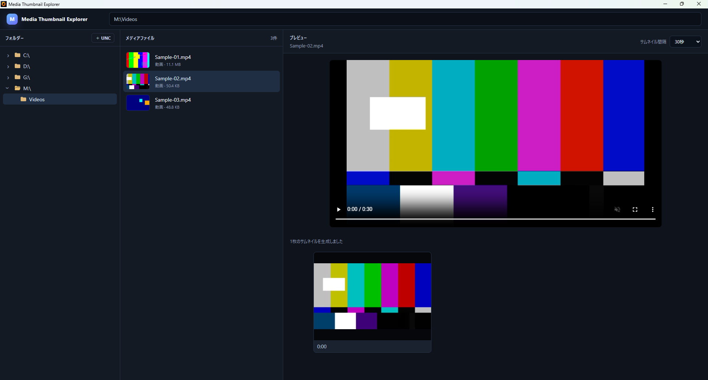

# v0.1.0 — 動画サムネイルのシーク精度修正

## 概要

Media Thumbnail Explorer の初期段階で、動画プレビュー用サムネイルを指定時刻から正しく取得できるようにしたバージョンです。

## 変更内容

- FFmpeg に渡すシーク位置を見直し、要求した時刻のフレームを取得するよう修正。
- 動画ストリーム選択を明示し、埋め込みカバー画像ではなく実際の動画フレームを対象にした。
- 動画プレビューで時刻ごとのサムネイルを生成できる基礎を整備。

## 開発中に確認した問題

初期実装では、指定した時刻と実際に取得されるフレームが一致しないケースがありました。FFmpeg の引数とストリーム選択を見直し、実動画のフレームを正確に取得する方式へ修正しました。

## 検証

複数の時刻を指定してサムネイルを生成し、同一フレームではなく時刻に応じたフレームが取得されることを確認しました。

## スクリーンショット

時刻ラベルごとに動画フレームを生成している状態です。
