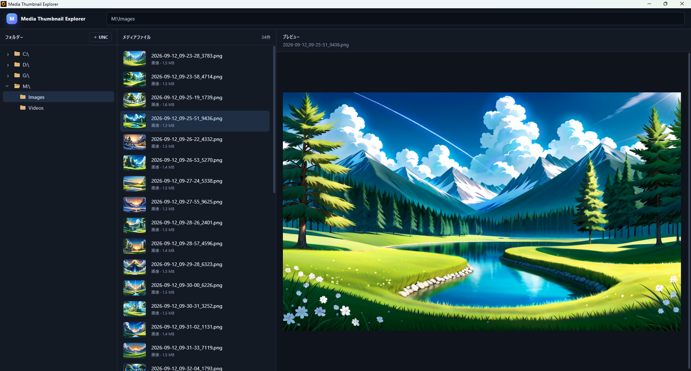

# v0.1.1 — 画像プレビュー操作の修正

## 概要

画像ファイルの選択とプレビュー操作を整理し、画像を扱う際の操作性を改善したバージョンです。

## 変更内容

- 画像選択時のプレビュー表示を整理。
- 画像プレビューをシングルクリックで扱えるよう変更。
- 動画のダブルクリックによる Windows 既定アプリでの再生は維持。

## 開発中に確認した問題

当初は画像側にもダブルクリック操作を追加しましたが、既存の選択・プレビュー操作と競合し、期待した挙動にならないケースがありました。

そのため、画像はシングルクリックでプレビュー、動画はダブルクリックで外部再生という役割分担に変更しました。失敗したダブルクリック実装は Git 履歴上に残し、その後の修正としてシングルクリック方式を採用しています。

## 検証

画像を選択した際にプレビューが更新され、動画のダブルクリック動作を壊していないことを確認しました。

## スクリーンショット

画像を選択し、右側のプレビュー領域へ表示している状態です。
