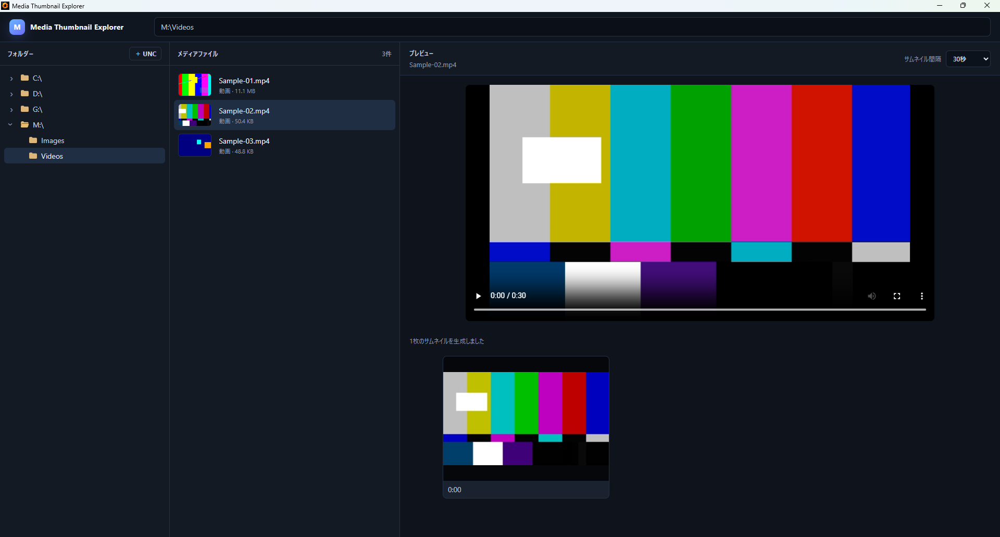

# v0.2.0 — メディア一覧サムネイル

## 概要

ファイル名中心だったメディア一覧を、画像・動画の内容を視覚的に確認できるサムネイル一覧へ拡張したバージョンです。

## 追加・変更内容

- メディア一覧へ画像サムネイルを追加。
- FFprobe で動画時間を取得。
- FFmpeg で動画の複数地点から候補フレームを抽出。
- 候補フレームから代表サムネイルを選択。
- 生成した動画サムネイルを一時ディレクトリへキャッシュ。
- フォルダーツリーへフォルダーアイコンと展開・折りたたみ表示を追加。

## 開発中に確認した問題と修正

最初のファイルブラウザー拡張パッチでは、既存コードとの差分が大きくなり、期待どおりに適用・動作しない箇所が発生しました。その後、構成を見直したパッチと追加修正を行っています。

また、DOM に追加される前の画像へ `loading="lazy"` を設定したことで、サムネイルの `load` が進まず表示されない問題が発生しました。画像要素を先に DOM へ追加してから `src` を設定する方式へ変更して解消しました。

開発途中には PowerShell の文字列書き換えによって日本語ソースが文字化けする事故も発生しました。以降、ソース更新はパッチを基本とし、PowerShell の `Get-Content | Set-Content` による直接書き換えを避ける方針にしています。

## 検証

画像・動画が混在するフォルダーで一覧サムネイルが表示され、動画ごとに代表フレームが生成されることを確認しました。

## スクリーンショット

動画一覧に実フレーム由来のサムネイルが表示されている状態です。
