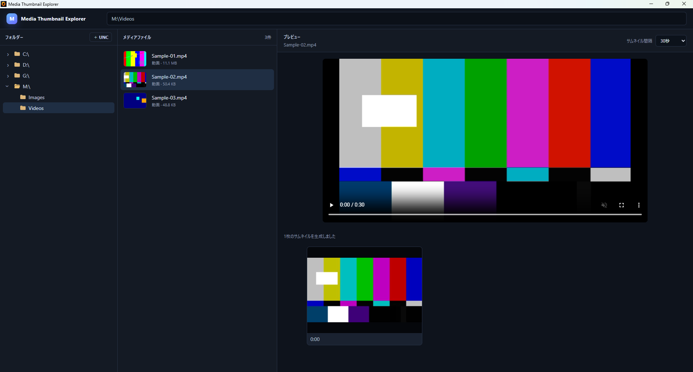

# v0.2.1 — フォルダーツリー展開表示の精度改善

## 概要

v0.2.0 で追加したフォルダーツリーの展開ボタンを修正し、実際に子フォルダーを持つフォルダーだけに展開表示を出すようにしたバグフィックス版です。

## 修正内容

- 各フォルダーが実際に子フォルダーを持つか確認する処理を追加。
- 子フォルダーが存在しない場合は展開ボタンを表示しないよう修正。
- ディレクトリー確認を同時実行しすぎないよう並列数を制限。
- アクセス権などで内部確認できないフォルダーは、開ける可能性を残すため展開可能として扱う。

## 背景

v0.2.0 時点では、フォルダーであることだけを基準に展開表示が付くため、実際には子フォルダーを持たない項目にも `>` が表示される状態でした。

ファイルシステムを実際に確認して `hasChildren` を返す方式へ変更し、ツリー表示と実際のディレクトリー構造を一致させました。

## 検証

子フォルダーを持つ項目には展開表示があり、末端フォルダーには不要な展開表示が出ないことを確認しました。

## スクリーンショット

子フォルダーの有無に応じて展開表示が変化するフォルダーツリーです。
