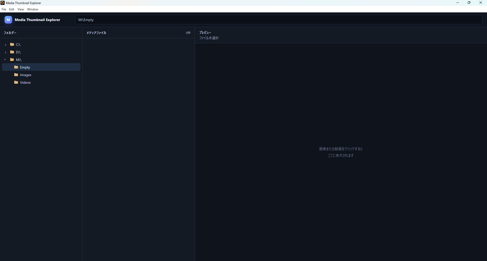

# v0.2.2 — Usability and Documentation

## 概要

v0.2.2 は、日常利用時の操作性、終了処理、状態復元、アプリ識別性、ドキュメント整備をまとめて改善するバージョンです。

## 1. 画像ビューアーのキーボード移動

フルスクリーン画像ビューアーで `←` / `→` キーを使い、同じフォルダー内の前後の画像へ移動できるようにしました。

- 動画は移動対象から除外。
- 先頭・末尾ではループしない。
- ビューアーを閉じている間は矢印キーを無視。
- 表示画像に合わせてファイル名も更新。
- `Esc` で閉じる既存操作を維持。

## 2. ウィンドウ状態の保存

終了時の通常ウィンドウサイズ・位置と最大化状態を保存し、次回起動時に復元するようにしました。

最小化状態そのものは保存せず、最小化中に終了した場合でも次回起動時は最後の通常サイズへ戻ります。

保存先には Electron の `userData` 配下にある `window-state.json` を使用します。

## 3. 終了時の子プロセス整理

FFmpeg / FFprobe の処理中にアプリを終了した場合、子プロセスが残って PowerShell へ制御が戻らない可能性が確認されました。

起動した子プロセスを追跡し、アプリ終了時に明示的に終了させる処理を追加しました。正常終了後に Electron / FFmpeg / FFprobe の孤立プロセスが残らないことを確認しています。

## 4. アプリケーションアイコン

`assets/icon.png` を追加し、Electron の `BrowserWindow` へアプリケーションアイコンとして設定しました。

実行中のウィンドウ、タスクバー、Alt+Tab でアイコンが反映されることを確認しました。パッケージ版 `.exe` のアイコン設定はパッケージング作業時に扱う予定です。

## 5. 最後に開いていたフォルダーの復元

終了前に選択していたフォルダーを `localStorage` に保存し、次回起動時に次の状態を復元するようにしました。

- 対象ドライブまでツリーを展開。
- 途中の親フォルダーを順番に展開。
- 最後に開いていたフォルダーを選択。
- そのフォルダーのメディア一覧を再表示。
- フォルダーが削除・移動されていた場合は保存値を破棄して通常の初期状態へフォールバック。

個別ファイルの選択状態と右側プレビューは v0.2.2 の復元対象には含めていません。

### 開発中の失敗

最初に作成した `restore-last-folder-v0.2.2.patch` は、差分作成時の基準ソースが現在のブランチ状態と一致しておらず、以前の画像ビューアー変更まで再度含んでいました。そのため `src/renderer/app.js` へ適用できませんでした。

現在のソース状態を再構築したうえで差分だけを取り直し、`restore-last-folder-v0.2.2-v2.patch` として修正しました。修正版は適用前チェック、JavaScript 構文チェック、差分チェックを通したうえで使用しています。

## 6. ルートドキュメント

ルートへ `README.md` と `CHANGELOG.md` を整備しました。

ドキュメントの言語ルールは次のとおりです。

- ルート `README.md`: 英語
- ルート `CHANGELOG.md`: 英語
- `doc/` 以下のバージョン別 `README.md`: 日本語

### 開発中の失敗

最初の README 更新では、既存 README が過去の文字コード破損によって文字化けしていることが判明しました。完成済み UTF-8 ファイルで置き換える方式へ変更しました。

さらに、最初の修正版 README を日本語で作成したため、ルートドキュメントを英語に統一する方針と不一致になりました。このテスト失敗も Git 履歴へ残し、その後 README を英語へ修正しています。

## テスト方針

v0.2.2 では、実装コミットとテスト結果コミットを分離しています。失敗したテストも削除・amend・squash せず、その時点の結果として履歴へ残します。

## スクリーンショット

再起動後、保存していたフォルダーまでツリーが自動展開され、対象フォルダーとメディア一覧が復元された状態です。右側プレビューが空なのは仕様どおりで、個別ファイル選択は復元対象外です。
