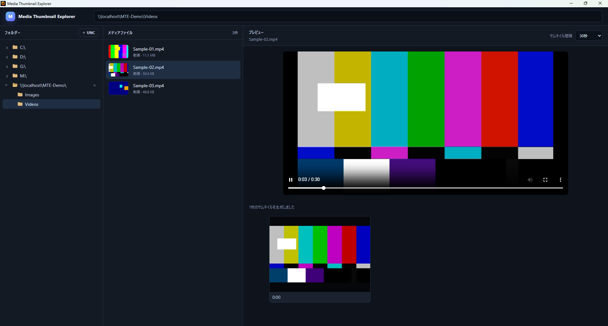

# v0.3.1 — UNC Path Registration

## 概要

v0.3.1 は、v0.3.0 で導入した Storage Provider 基盤を利用し、Windows の UNC パスを直接登録して閲覧できるようにするバージョンです。

UNC パスをアドレスバーから直接開いた場合も共有ルートを自動登録し、登録内容はアプリケーション再起動後も保持します。ローカルファイル閲覧の既存動作は維持します。

## 1. UNC パスの登録と直接ナビゲーション

UNC 形式の共有パスを登録し、ネットワーク共有上のフォルダーへ直接移動できるようにしました。

アドレスバーへ UNC パスを入力した場合は、その共有ルートを自動的に登録します。これにより、事前に別操作で共有先を追加しなくても、入力した UNC パスから閲覧を開始できます。

## 2. UNC 登録の永続化

登録した UNC 共有ルートは保存され、Media Thumbnail Explorer を終了して再起動した後も利用できます。

Windows 実機では、再起動後に登録済み UNC ルートが残っていること、そのルートからフォルダーを開き、画像・動画を表示できることを確認しました。

## 3. 動画プレビューの音量保持

動画プレビューで設定した音量とミュート状態を、別の動画へ切り替えた際にも引き継ぐようにしました。

この保持はアプリケーションを起動している間のみです。アプリケーションを終了して再起動した場合は、音量 100%・ミュート解除の初期状態へ戻ります。

## 4. 実機退行テスト

Windows 実機で次の項目を確認し、正常であることを確認しました。

- UNC パスの登録と直接ナビゲーション
- アドレスバーから開いた UNC 共有ルートの自動登録
- アプリケーション再起動後の UNC 登録保持
- 登録済み UNC 共有上のフォルダー閲覧
- UNC 共有上の画像・動画表示
- 動画切り替え後の音量保持
- 動画切り替え後のミュート状態保持
- アプリケーション再起動時に動画音量が初期状態へ戻る仕様

実装コミットとテスト結果コミットは従来どおり分離して Git 履歴へ記録しています。

## 5. v0.3.x の次段階

v0.3.2 では、ネットワーク共有を日常的に利用する際の異常系への対策を進める予定です。

- 共有先の切断
- アクセス権限エラー
- ネットワークアクセスのタイムアウト

## スクリーンショット

UNC 共有上の動画を Media Thumbnail Explorer でプレビューしている状態です。

