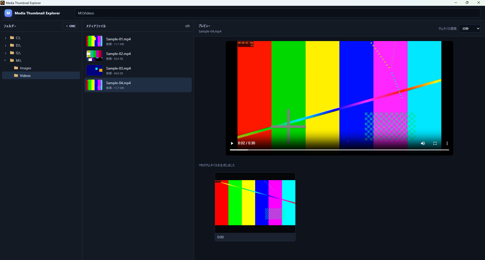

# v0.3.4 — Video Audio Preference Persistence

## 概要

v0.3.4 は、動画プレビューの音量とミュート状態をアプリケーション終了後も保持するバージョンです。

v0.3.1 では動画を切り替えた際の音量とミュート状態をアプリケーション起動中のみ保持していました。v0.3.4 ではこの設定を永続化し、Media Thumbnail Explorer を終了して再起動した後も復元します。

## 1. 動画音量の永続化

動画プレビューで設定した音量を保存するようにしました。

アプリケーションを終了して再起動した場合も、前回設定した音量が新しい動画プレビューへ適用されます。

## 2. ミュート状態の永続化

動画プレビューのミュート状態も音量と同様に保存します。

アプリケーション終了時にミュートしていた場合は、次回起動後の動画プレビューでもその状態を復元します。

## 3. 実機退行テスト

Windows 実機で次の項目を確認し、正常であることを確認しました。

- 動画プレビューの音量変更
- 動画切り替え後の音量保持
- 動画切り替え後のミュート状態保持
- アプリケーション再起動後の音量復元
- アプリケーション再起動後のミュート状態復元

実装コミットとテスト結果コミットは従来どおり分離して Git 履歴へ記録しています。

## スクリーンショット

動画プレビューの音量設定を確認できる画面です。

