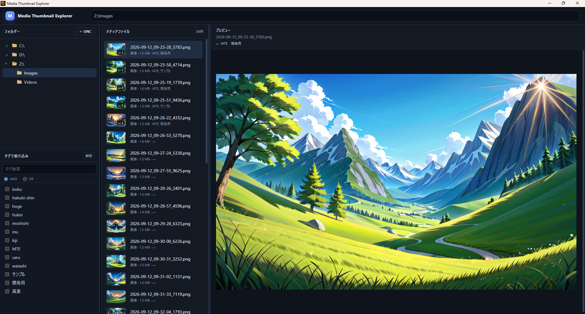
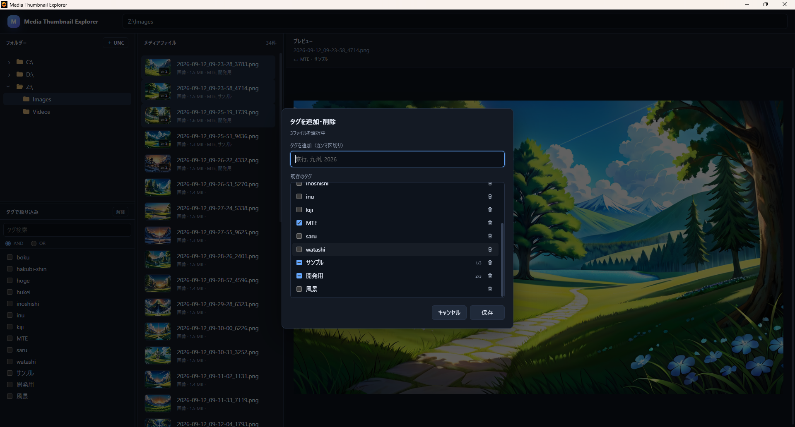
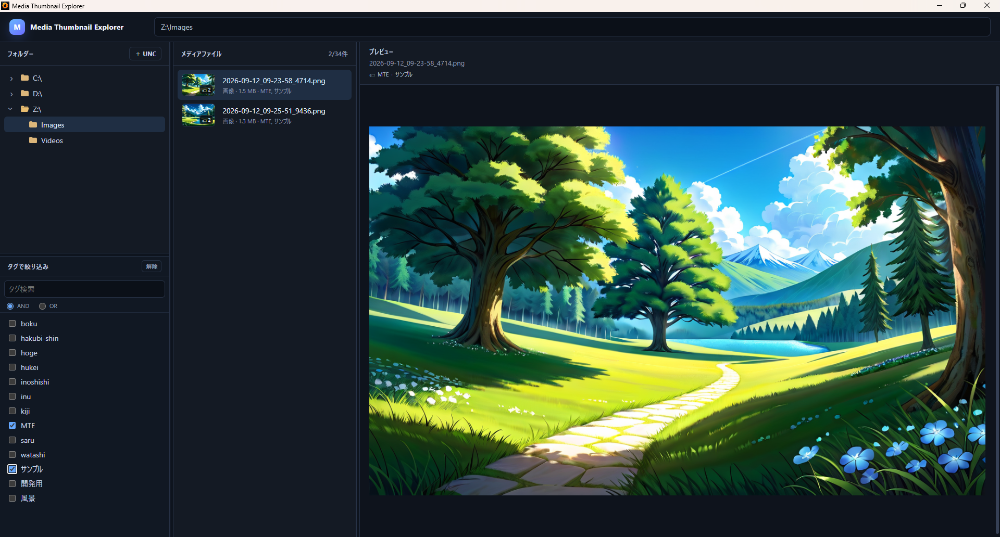

# v0.5.0 — File Tagging and Filtering

## 概要

v0.5.0 は、画像・動画へ任意のタグを付け、タグを使って現在のフォルダー内のメディアを絞り込めるようにするバージョンです。

タグ情報はメディアファイルそのものへ書き込まず、Media Thumbnail Explorer のローカルメタデータとして保持します。単一ファイルだけでなく複数ファイルへの一括編集、AND / OR 条件による絞り込み、タグ領域と各ペインのサイズ調整にも対応します。

## 1. SQLite メタデータストア

タグ情報の永続化には Node.js の `node:sqlite` / `DatabaseSync` を使用します。データベースは Electron の `app.getPath('userData')` 配下の `mte.db` に作成し、メインプロセスだけが直接アクセスします。Renderer からの操作は preload / IPC を経由します。

スキーマ v1 は次の3テーブルで構成します。

- `files`: MTE がタグ情報を保持するファイル
- `tags`: タグ定義
- `file_tags`: ファイルとタグの関連付け

タグ名は前後の空白を除去し、大文字・小文字を区別せず一意に扱います。同じタグを重複指定した場合も1件へ集約します。タグ名には空白を含められます。

メディアファイル自体にはタグ情報を書き込みません。

## 2. タグの追加・削除と複数選択

メディア一覧の右クリックメニューから「タグを追加・削除」を開き、選択ファイルへタグを設定します。

- 新しいタグをカンマ区切りで入力
- 既存タグをチェックボックスから選択
- `Ctrl` / `Shift` を使った複数ファイル選択
- 複数選択時は、全ファイルに付いているタグ、一部だけに付いているタグ、付いていないタグを区別
- 一部のファイルだけに付いているタグは三状態チェックと `1/3`、`2/3` のような件数で表示
- 複数ファイルへタグの追加・解除を一括反映
- 不要になったタグ定義は確認ダイアログを経て削除

ファイルからタグを解除しても、その操作だけではタグ定義を削除しません。

## 3. タグフィルタ

フォルダーツリーの下へ「タグで絞り込み」ペインを常設しました。

- タグ名検索
- 複数タグ選択
- AND / OR 条件の切り替え
- 選択条件の解除
- フィルタ結果件数の表示

AND では選択したタグをすべて持つファイル、OR では選択したタグのいずれかを持つファイルを表示します。

## 4. タグ表示

メディア一覧では、ファイル名の下のメタ情報行へファイル種別・サイズとともにタグ名を表示します。サムネイル上には付与タグ数のバッジも表示します。

プレビュー上部では選択ファイルのタグを1行で表示し、表示領域を超える場合は残り件数をまとめて表示します。

## 5. ペインサイズの調整と保存

フォルダー領域とタグフィルタ領域の境界をドラッグして高さを変更できます。また、フォルダー / メディア一覧 / プレビューの境界もドラッグして横幅を変更できます。

これらの比率はローカルへ保存し、次回起動時に復元します。

## 6. ファイル移動の扱い

v0.5.0 のタグ情報はファイルパスを基準に管理します。MTE の外部で Explorer などを使ってファイルを移動・名前変更した場合、その追跡や自動照合は行いません。変更後のパスは別のファイルとして扱います。

ファイルハッシュ、Windows File ID、内容フィンガープリントなどによる外部移動追跡は v0.5.0 の対象外です。

## 7. 検証

自動テストでは、タグ機能に加えて既存機能の回帰も確認しています。主な確認項目は次のとおりです。

- SQLite schema v1 の作成と永続化
- タグ名の trim と大文字・小文字を区別しない重複排除
- 複数タグの割り当てと重複割り当て防止
- タグ解除と不要になったファイルメタデータの整理
- タグ定義削除時の関連付け削除
- 複数ファイルへの一括タグ更新
- タグフィルタ、複数選択、三状態タグ編集、タグ表示の UI contract
- UNC メディア列挙の回帰
- FFmpeg 設定エラーの表示
- プレビューキャンセルとメディア処理ジョブ制御

リリース文書完成後は `npm run release:gate` で、バージョン、CHANGELOG、版別開発記録、画像参照、ライセンス、Git 状態、自動テストの整合性を確認します。

## スクリーンショット

### タグ機能の全体表示

フォルダーツリー下のタグフィルタ、メディア一覧のタグ情報、プレビュー上部のタグ表示を含む v0.5.0 の全体画面です。

### 複数ファイルのタグ編集

3ファイルを選択したタグ編集画面です。全ファイル共通のタグに加え、一部だけに付いているタグを三状態チェックと `1/3`、`2/3` の件数表示で確認できます。

### AND 条件によるタグ絞り込み

`MTE` と `サンプル` の2タグを AND 条件で選択し、34件から2件へ絞り込んだ状態です。
